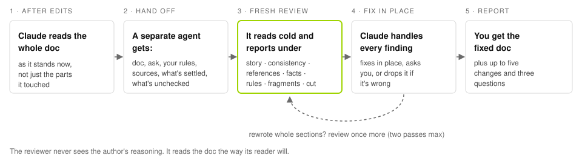

# doc-check

A skill for Claude that rereads a whole doc with a fresh reviewer after every round of edits, and fixes what it finds before you see it.

## Why I built it

I'm a product manager, and I write a lot of proposals and scopes with Claude. On one proposal, I had Claude work through comments one at a time. Every edit was right where it was made, but the doc drifted as a whole. "Pictured above" pointed at an image that had moved below it. An item sat in both the MVP list and the "not in v1" list. A question we had already decided was still listed as open. And the story no longer read clearly from the top.

I caught all of it; Claude didn't. The author can't see drift, because it reads what it meant. So I wanted the check done by a reader who doesn't know what was meant, and I wanted it to happen without me asking.

## How it works



The reviewer gets the doc, who it's for, your writing rules (from your CLAUDE.md, memory and the chat) and the sources the facts came from. It also gets what's settled (your own words and the decisions you've made, which it can question but not cut) and which claims Claude checked against a source and which it didn't. It does not get Claude's reasoning.

Claude then handles every finding: it fixes it in place (no "Update:" notes), asks you, or drops it if it's wrong. You get a short report. Short replies, like a Slack message, get a quick check without the reviewer.

## What you get back

This is a real report from one eval run, on a test proposal with planted problems:

> I checked the whole doc and fixed it. It's ready for eng and design, apart from the questions below.
>
> **Changes**
> - Took email alerts out of the v1 list. They now appear only under "Not in v1".
> - Changed "v1 has three parts" to "v1 includes:", because the list had more than three items.
> - Removed the open question about a 10 or 20 limit, since you settled on 20 on Nov 6.
> - Reworded the sharing question to ask about sharing after v1, since v1 is already decided as private.
> - Changed "pictured above" to "pictured below", because the image comes after that sentence.
>
> **Questions**
> 1. Is the badge for new results really in v1? It needs the same new-results tracking as email alerts, and it sat right next to the alerts line. I'd move it to "Not in v1" with alerts.
> 2. The doc tells your design lead there is "no new design work", but the save button and the badge are both new. I'd change it to "little new design work: a save button on the filter bar".
> 3. The rollout says to go wide "if the save rate holds", but there's no current save rate to hold. I'd name a target, such as "if X% of students in the 10% save a search".

## What it caught on a real doc

The first real run was on a product proposal that had been edited comment by comment. The first review pass caught, among others:

| The doc said | The catch | Now |
|---|---|---|
| A total for the build table | The table's own rows added up to more | Total matches the rows |
| How long similar past work took, measured from PR opened to PR merged | That's review time: the PRs were all opened within two minutes of each other | Compared by size (lines of code) instead |
| The page is hidden from search, and should sit near pages that search engines already rank | The two contradict each other | The search reason is gone |
| Where the page will live, stated as fact | The same doc lists that as an open question | "would live" |
| A title from an earlier version of the doc | It named an option the doc no longer proposed | New title, after asking me |
| The page's two addresses used different words for the same thing | Same idea, two words | One word in both, after asking me |

It also asked before touching my own heading for a section.

## Does it work?

On its first day I ran it 15 times on 7 real docs, and every pass caught something worth fixing.

I also wrote evals: four test docs (three with planted problems, one clean), each checked by a fresh Claude twice, with 60 pass/fail checks in all.

| Version | Passed | What went wrong |
|---|---|---|
| 0.1.0 | 50/60 | Every report ran long (one was 423 words); it started a reviewer agent for a two-sentence reply |
| 0.2.0 | 59/60 | One run left a decided question listed as open |

Version 0.2.0 added the "settled" and "checked vs unchecked" handoff, the quick check for short replies, a short-report rule, and a rule that every finding gets handled. The evals also checked themselves: the reviewer caught that one of my test docs had dates on the wrong weekdays. See [evals/README.md](evals/README.md) to run them.

## Install

In Claude Code:

```
/plugin install doc-check --marketplace jacobksamuelson/doc-check
```

Or copy `skills/doc-check` into `~/.claude/skills/`.

Claude runs it on its own after writing or editing a doc. You can also ask: "check this doc", "does this make sense?", "clean up the doc".

## License

MIT
